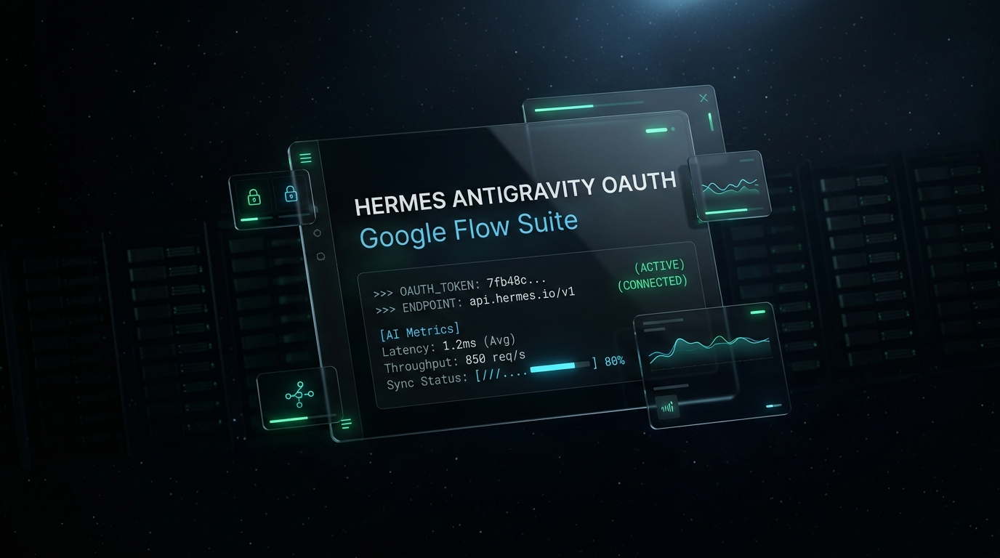

# 🌟 Hermes Antigravity OAuth & Google Flow Multi-Provider Suite

<div align="center">
  
</div>

> **Bộ giải pháp mở rộng cao cấp cho Hermes Agent**, tích hợp toàn diện hệ thống mô hình AI tiên tiến từ tài khoản **Google Antigravity OAuth** (Gemini 2.5/3.7, Claude 3.5/3.7 Sonnet & Opus, GPT-OSS 120B), **Sinh ảnh AI** (Gemini 3.1 Flash Image) và **Sinh video điện ảnh Google Flow** (Google Veo 3.1 & Omni 1.1 Flash) vào Hermes Agent — hoạt động ổn định trên CLI, Telegram, Discord, TUI và Web Dashboard.

**Phiên bản:** `v3.1.0 (Tháng 09/2026 - Production Ready)`  
**Tác giả:** Nguyen Phap  
**Bản quyền:** MIT / Apache 2.0  

> [!CAUTION]
> **TUYÊN BỐ MIỄN TRỪ TRÁCH NHIỆM (DISCLAIMER):**  
> Dự án này là công cụ mã nguồn mở độc lập phục vụ mục đích học tập và nghiên cứu kỹ thuật cá nhân, không có mối liên kết chính thức với Google LLC. Việc sử dụng các cơ chế tự động hóa hoặc trích xuất phiên có thể tiềm ẩn nguy cơ vi phạm Điều khoản Dịch vụ của Google dẫn đến việc tài khoản bị khóa, đình chỉ hoặc giới hạn tính năng. Tác giả và cộng đồng phát triển **tuyệt đối không chịu trách nhiệm** cho bất kỳ rủi ro hay thiệt hại nào đối với tài khoản Google của bạn. Khuyến khích sử dụng tài khoản phụ cho mục đích thử nghiệm. Chi tiết xem tại mục [Tuyên Bố Miễn Trừ Trách Nhiệm](#-tuyen-bo-mien-tru-trach-nhiem-disclaimer).

---

## 📌 Tổng Quan & Các Trụ Cột Tính Năng

```
                  ┌──────────────────────────────────────────────┐
                  │          HERMES AGENT ECOSYSTEM              │
                  │   (CLI, Telegram, Discord, Web Dashboard)    │
                  └──────┬───────────────────┬───────────────────┘
                         │                   │
         ┌───────────────▼────────┐  ┌───────▼──────────────────┐
         │  Model Provider Plugin │  │ Image & Video Providers  │
         │ (plugins/model-prov...)│  │ (plugins/image_gen, ...) │
         └───────────────┬────────┘  └───────┬──────────────────┘
                         │                   │
                         ▼                   ▼
    ┌───────────────────────────────────────────────────────────────┐
    │              ANTIGRAVITY LOOPBACK BRIDGE ENGINE               │
    │                   (tools/antigravity_bridge)                  │
    ├───────────────────────────────┬───────────────────────────────┤
    │  • OAuth 2.0 PKCE Multi-Acc   │  • Camofox Browser Bridge     │
    │  • Credential Pool Strategies │  • reCAPTCHA Enterprise Token │
    │  • Token Auto-Refresh Daemon  │  • Google Flow Generator      │
    │  • 32+ Dynamic Model Catalog  │  • Local HTTP Proxy (v1 API)  │
    └───────────────────────────────┴───────────────────────────────┘
```

### 1. 🧠 LLM Chat & Code Assist (`plugins/model-providers/antigravity`)
- **Tương thích hoàn toàn OpenAI API**: Cung cấp máy chủ proxy cục bộ tại `http://127.0.0.1:8100/v1` (`/v1/chat/completions`, `/v1/models`).
- **Dynamic Model Discovery (32+ Mô hình)**: Tự động khám phá danh mục mô hình theo quyền hạn tài khoản (Gemini 3.7 Flash/Pro, Gemini 2.5 Flash/Pro, Claude 3.5/3.7 Sonnet, Claude 3.7 Sonnet Thinking, Claude Opus 4.6, GPT-OSS 120B).
- **Multi-Modal Vision**: Nhận diện và phân tích ảnh đính kèm (base64 hoặc URL) tự động chuyển đổi sang format `inlineData` của Google.
- **Native Structured Tool Calling**: Dịch chuyển đổi mượt mà JSON Schema của OpenAI sang Google `functionDeclarations`, tuân thủ nghiêm ngặt chuẩn luân phiên tin nhắn (role alternation) của Hermes.
- **Reasoning / Thinking Forwarding**: Hỗ trợ đầy đủ tham số tư duy (`thinking_config`) cho các dòng model Thinking.
- **Daemon Auto-Wake**: Tự động kiểm tra và khởi động tiến trình cầu nối ngầm khi Hermes Agent cần, không yêu cầu khởi động thủ công.

### 2. 🔑 OAuth 2.0 PKCE & Credential Pool (`tools/antigravity_bridge`)
- **1-Click Browser Login**: Đăng nhập tài khoản Google trực quan qua trình duyệt bằng luồng OAuth 2.0 PKCE tiêu chuẩn, tự động nhận và lưu Refresh Token.
- **Multi-Account Pool**: Quản lý song song nhiều tài khoản Google độc lập trên cùng một profile Hermes.
- **4 Chiến lược cân bằng tải**:
  - `fill_first`: Sử dụng cạn hạn mức tài khoản hiện tại rồi mới chuyển tiếp.
  - `round_robin`: Xoay vòng tuần tự qua từng tài khoản sau mỗi lượt chat.
  - `least_used`: Ưu tiên tài khoản có số lượt yêu cầu thấp nhất.
  - `random`: Lựa chọn ngẫu nhiên tài khoản đang hoạt động.
- **Tự động Cooldown & Chuyển giao lỗi**: Khi gặp mã lỗi `429 Too Many Requests` hoặc hết hạn mức, hệ thống tự động đưa tài khoản vào trạng thái `COOLING_DOWN` và chuyển sang tài khoản kế tiếp ngay lập tức.
- **Background Token Refresh Daemon**: Tự động theo dõi vòng đời access token và âm thầm gia hạn trước khi hết hạn (chặn hoàn toàn lỗi `401 Unauthorized`).

### 3. 🖼️ AI Image Generation Backend (`plugins/image_gen/antigravity`)
- **Tích hợp Core Tool `image_generate`**: Đăng ký làm nhà cung cấp chuẩn `ImageGenProvider` mang tên `antigravity`.
- **Mô hình**: Sử dụng `gemini-3.1-flash-image` (hoặc Imagen 3) qua tài khoản Google Antigravity.
- **Đa dạng tỷ lệ & chế độ**: Hỗ trợ đầy đủ `1:1`, `16:9`, `9:16`, `4:3`, `3:4`. Hỗ trợ cả Text-to-Image và Image-to-Image (dùng ảnh làm mẫu tham chiếu).
- **Cơ chế Auto-Healing**: Tự động phát hiện và khôi phục thư mục bridge nếu bị mất mát sau các đợt cập nhật git.

### 4. 🎬 AI Video Generation - Google Flow Veo 3.1 (`plugins/video_gen/antigravity`)
- **Tích hợp Core Tool `video_generate`**: Đăng ký làm nhà cung cấp video chính thức cho Hermes (`VideoGenProvider: antigravity`).
- **Camofox Anti-Detection & Sandbox Bridge**:
  - Tự động điều khiển và trích xuất token `reCAPTCHA Enterprise` hợp lệ gửi lên endpoint `aisandbox-pa.googleapis.com` (khắc phục triệt để mã lỗi `403 Forbidden`).
  - **Headless Auto-Refresh & Keep-Alive Daemon**: Tự động duy trì phiên làm việc 30 ngày (Rolling Session) ngầm mà người dùng không cần giữ tab trình duyệt mở.
- **Bảng phân tầng 5 cấp độ chất lượng thông minh theo ý định người dùng**:
  1. **Miễn phí 100% (0 credit)**: `veo-3.1-lite-free` (4s) — Xem trước, làm nháp, thử nghiệm kịch bản.
  2. **Tiết kiệm (5 credits)**: `veo-3.1-lite` (6s) — Sinh video siêu tốc, chi phí tối thiểu.
  3. **Tiêu chuẩn (6 credits)**: `omni-1.1-flash` (10s) — **Mặc định**, cân bằng tối ưu, có âm thanh tự nhiên.
  4. **Cao cấp (10 credits)**: `veo-3.1-fast` (10s) — Chuyển động vật lý mượt mà, độ nét cao.
  5. **Cực phẩm Studio (100 credits)**: `veo-3.1-quality` (10s) — Chuẩn điện ảnh chiếu rạp, chi tiết quang học tối đa.
- **Tự động tải & gửi**: Tự động theo dõi tiến độ sinh video, tải file `.mp4` chuẩn về đĩa cứng (`~/.hermes/media/flow/`) và gửi thẳng vào Telegram/Discord.
- **Kèm Skill chuyên dụng**: `skills/ai-video-generation` hướng dẫn bot tự động chọn `video_generate` thay vì tự ghép ảnh qua FFmpeg.

### 5. 🌐 Web Dashboard & Runtime Dynamic Injector (`injector.py`)
- **Nguyên lý Zero Core Modifications**: Không sửa đổi cố định các file git gốc của Hermes Agent.
- **Monkey-Patching động trong RAM**: Tự động hook vào FastAPI Web Server lúc khởi động để tiêm giao diện thẻ Antigravity, bộ chọn mô hình (Model Picker) và các API quản lý tài khoản:
  - `/api/credentials/providers/antigravity/accounts`
  - `/api/credentials/providers/antigravity/oauth/start`
  - `/api/credentials/providers/antigravity/oauth/poll`

---

## 📂 Cấu Trúc Thư Mục Dự Án

```
Hermes-Antigravity-OAuth-Plugin/
├── README.md                      # Tài liệu hướng dẫn Tiếng Anh (English Documentation)
├── README_VN.md                   # Tài liệu hướng dẫn Tiếng Việt (file này)
├── Login_Google_Flow.cmd          # Tiện ích 1-Click mở đăng nhập Google Flow tương tác
├── install.py                     # Trình cài đặt tự động 1-Click đa profile & đa workspace
├── manage.py                      # CLI quản trị Bridge, Account Pool & Google Flow
│
├── plugin/                        # Hermes Model Provider Plugin
│   ├── plugin.yaml                # Khai báo metadata provider
│   ├── __init__.py                # ProviderProfile & Auto-wake bridge
│   └── injector.py                # Dynamic FastAPI Runtime Injector
│
├── bridge/                        # Antigravity Runtime Bridge Engine
│   ├── auth.py                    # OAuth PKCE Manager & Token Persistence
│   ├── account_pool.py            # Multi-account pool & 4 chiến lược xoay vòng
│   ├── client.py                  # Bộ biên dịch OpenAI ↔ Gemini Code Assist
│   ├── models.py                  # Live Discovery 32+ Models & Caching
│   ├── server.py                  # Máy chủ HTTP Proxy cục bộ port 8100
│   │
│   └── flow/                      # Cầu nối Google Flow Veo 3.1
│       ├── camofox_bridge.py      # Điều khiển Camofox & trích xuất reCAPTCHA Enterprise
│       ├── flow_refresh_daemon.py # Tự động làm mới Flow token nền
│       ├── flow_auth_service.py   # Quản lý phiên đăng nhập Google Flow
│       ├── account_pool.py        # Quản lý tài khoản Flow độc lập
│       ├── generators.py          # API sinh video Text-to-Video & Image-to-Video
│       └── tools.py               # Khai báo model tools
│
├── image_gen/antigravity/         # Image Generation Plugin
│   ├── plugin.yaml                # Khai báo Image provider
│   └── __init__.py                # ImageGenProvider & Auto-heal logic
│
├── video_gen/antigravity/         # Video Generation Plugin (Google Flow)
│   ├── plugin.yaml                # Khai báo Video provider
│   └── __init__.py                # VideoGenProvider (5 tiers & auto-routing)
│
├── dashboard/                     # Web Dashboard Assets
│   └── plugin_api.py              # Dashboard API handler
│
└── skills/ai-video-generation/    # Skill hướng dẫn Agent tạo video
    └── SKILL.md                   # Chỉ dẫn ưu tiên tool video_generate
```

---

## 📋 Yêu Cầu Chuẩn Bị Trước Khi Cài Đặt (Prerequisites Checklist)

Trước khi chạy trình cài đặt `install.py`, hãy đảm bảo môi trường của bạn đã sẵn sàng các thành phần sau:

### 1. Môi Trường Phần Mềm & Công Cụ (Runtime & Tools)
- **Python:** Phiên bản `>= 3.10` (Khuyên dùng `3.11` – `3.12`, hỗ trợ hoàn toàn `3.14`).
- **Node.js & npm:** Phiên bản `18+` (Khuyên dùng `20+` hoặc `22+`) — Cần thiết khi vận hành Camofox server phục vụ tính năng Tạo Video Google Flow.
- **Google Chrome:** Đã cài đặt trên máy và đăng nhập tài khoản Google (dùng cho 1-Click PKCE Login và Flow Handshake).
- **Hermes Agent:** Đã clone kho mã nguồn `hermes-agent` và khởi tạo thư mục cấu hình `~/.hermes`.

### 2. Cài Đặt Các Thư Viện Python Phụ Thuộc
Chạy lệnh sau trong môi trường Python / Virtualenv của Hermes:
```bash
# 1. Các thư viện cốt lõi cho Bridge Server, Model Discovery & Quản trị Pool
pip install aiohttp httpx requests pyyaml

# 2. Thư viện tự động hóa trình duyệt (Bắt buộc nếu sử dụng tính năng Tạo Video Google Flow)
pip install playwright
playwright install chromium
```
> [!NOTE]
> Nếu bạn chỉ sử dụng **LLM Chat/Code Assist** và **Sinh ảnh (Image Gen)**, bạn chỉ cần nhóm 1 (`aiohttp httpx requests pyyaml`). Thư viện `playwright` là bắt buộc khi sử dụng tính năng **Tạo video Google Flow** (`manage.py flow-login` / `flow-handshake`).

### 3. Chuẩn Bị Tài Khoản & Hạn Mức Google
- **Tài khoản Google Antigravity:**
  - Ít nhất **1 tài khoản Google** có quyền truy cập Google Antigravity / Google Cloud Code Assist.
  - *Khuyên dùng:* Chuẩn bị **2 - 3 tài khoản** để đưa vào Multi-Account Pool (`python manage.py login`), giúp hệ thống tự động xoay vòng và cooldown khi chạm giới hạn hạn mức (`429 Too Many Requests`).
- **Tài khoản Google Flow (Tạo Video AI):**
  - Tài khoản có thể truy cập [Google Flow Studio](https://labs.google/fx/tools/flow).
  - Có sẵn tín dụng AI (credits) nếu muốn tạo video ở các tầng chất lượng cao (5 - 100 credits), hoặc sử dụng tầng miễn phí `veo-3.1-lite-free` (0 credit).

### 4. Cổng Mạng Nội Bộ (Port) & Kết Nối Internet
- Đảm bảo các cổng mạng localhost sau không bị ứng dụng khác chiếm dụng hoặc bị Firewall chặn:
  - `Port 8100`: Antigravity Local Reverse-Proxy Bridge (`http://127.0.0.1:8100/v1`).
  - `Port 51121`: OAuth 2.0 PKCE Redirect Server (`http://localhost:51121/oauth-callback`).
  - `Port 9377`: Camofox Browser Server (phục vụ kết nối Google Sandbox API).
- Đảm bảo máy tính có thể kết nối thông suốt tới các domain của Google (`accounts.google.com`, `daily-cloudcode-pa.googleapis.com`, `cloudcode-pa.googleapis.com`, `labs.google`, `aisandbox-pa.googleapis.com`). Nếu ở vùng địa lý bị Google Flow giới hạn, hãy bật VPN thích hợp trước khi đăng nhập.

---

## 🚀 Hướng Dẫn Cài Đặt & Sử Dụng

### Cách 1: Cài đặt tự động 1-Click (Khuyên Dùng)

Chỉ cần chạy lệnh sau từ thư mục plugin:
```bash
python install.py
```

**Trình cài đặt thông minh sẽ tự động:**
1. Quét tìm tất cả các thư mục Hermes (`~/.hermes`, `AppData/Local/hermes`, các profile `test-bot1`, `test-bot2`...).
2. Quét tìm tất cả repository `hermes-agent` trên máy.
3. Đồng bộ Plugin, Bridge, Image Gen, Video Gen và Dashboard vào toàn bộ hệ thống.
4. Cài đặt `git post-merge hook` trong `.git/hooks/` để tự động phục hồi plugin sau mỗi lần `git pull`.
5. Dọn dẹp sạch sẽ các cache model cũ để danh mục mô hình mới có hiệu lực ngay lập tức.

---

### Cách 2: Quản lý qua Dòng Lệnh CLI (`manage.py`)

Thư mục cung cấp công cụ `manage.py` để bạn kiểm tra và quản trị toàn bộ hệ thống:

```bash
# 1. Xem trạng thái tổng quan (Tài khoản, Bridge, Flow, Camofox)
python manage.py status

# 2. Đăng nhập thêm tài khoản Google Antigravity OAuth mới
python manage.py login

# 3. Quản lý danh sách tài khoản trong Pool
python manage.py pool list
python manage.py pool set-strategy round_robin

# 4. Kiểm tra, làm mới và xác thực Google Flow Veo 3.1
python manage.py flow-status       # Xem trạng thái, email, hạn token ya29 và cookie 30 ngày
python manage.py flow-refresh      # Làm mới token ngầm (headless direct session)
python manage.py flow-login        # Đăng nhập trực quan qua trình duyệt (hoặc click Login_Google_Flow.cmd)

# 5. Khởi động / Dừng Bridge thủ công (nếu cần)
python manage.py start
python manage.py stop
```

---

## 🛡️ Đánh Giá Độ Bền Vững Khi Hermes Update (`git pull`)

Một trong những ưu tiên hàng đầu của phiên bản `v3.0.0` là **khả năng chống mất mát cấu hình và lỗi khi Hermes core cập nhật**:

| Thành phần | Nơi lưu trữ | Đánh giá | Cơ chế bảo vệ |
| :--- | :--- | :---: | :--- |
| **Tokens & Multi-Account** | `~/.hermes/auth/` | 🟢 **100% Bền vững** | Nằm ngoài thư mục git repository, không bao giờ bị xóa khi `git pull`. |
| **Cấu hình `config.yaml`** | `~/.hermes/config.yaml` | 🟢 **100% Bền vững** | Nằm ngoài git repo, bảo toàn mọi thiết lập provider. |
| **Plugin Người dùng** | `~/.hermes/plugins/` | 🟢 **100% Bền vững** | Hermes tự động ưu tiên nạp plugin từ `~/.hermes/plugins/`. |
| **Bridge Runtime Engine** | `~/.hermes/bridge/` | 🟢 **100% Bền vững** | Plugin tự tìm kiếm bridge trong `~/.hermes/bridge/` nếu repo bị xóa. |
| **Workspace Bridge** | `tools/antigravity_bridge` | 🟢 **Tự phục hồi** | Plugin `image_gen` có logic **Auto-Heal** tự copy lại nếu bị xóa. |
| **Dashboard UI** | RAM (Runtime) | 🟢 **95% Bền vững** | Dùng `injector.py` monkey-patch trong RAM, không sửa file gốc. |
| **Core tool `video_generate`** | `toolsets.py` | 🟡 **Tự khôi phục qua Hook** | Tự động chèn lại vào `toolsets.py` qua Git post-merge hook hoặc chạy `install.py` sau khi update. |

### ⚠️ Khuyến nghị cập nhật an toàn:
Để tránh xung đột git (`git conflict`) do các thay đổi cục bộ trong repo `hermes-agent`, bạn chỉ cần chạy chuỗi lệnh tiêu chuẩn:
```bash
git stash
git pull
python install.py
```

---

## 🎬 Bảng Phân Tầng Mô Hình Video Google Flow Veo 3.1

Người dùng **không cần nhớ ID mô hình**. Hermes Agent sẽ tự động ánh xạ thông minh từ prompt của bạn sang tầng tương ứng:

| Tầng chất lượng | Model Key | Thời lượng | Tín dụng | Từ khóa nhận diện trong Prompt |
| :--- | :--- | :---: | :---: | :--- |
| **Miễn phí (Free)** | `veo-3.1-lite-free` | 4 giây | **0 credit** | `miễn phí`, `free`, `0 credit`, `làm nháp`, `thử nghiệm` |
| **Tiết kiệm (Lite)** | `veo-3.1-lite` | 6 giây | **5 credits** | `tiết kiệm`, `nhanh nhất`, `rẻ nhất`, `5 credit`, `veo lite` |
| **Tiêu chuẩn (Standard)** | `omni-1.1-flash` | 10 giây | **6 credits** | *(Mặc định)*, `tiêu chuẩn`, `có tiếng`, `âm thanh`, `omni` |
| **Cao cấp (Fast)** | `veo-3.1-fast` | 10 giây | **10 credits** | `cao cấp`, `chất lượng cao`, `sắc nét`, `đẹp nhất`, `10 credit` |
| **Cực phẩm (Quality)** | `veo-3.1-quality` | 10 giây | **100 credits**| `cực phẩm`, `đỉnh cao`, `điện ảnh`, `chiếu rạp`, `100 credit` |

---

## 🔄 Cơ Chế Quản Lý & Duy Trì Phiên Đăng Nhập (3-Tier Auth Lifecycle & Rolling Session)

Để đảm bảo tính năng sinh video Google Flow Veo 3.1 luôn hoạt động sẵn sàng 24/7 mà không làm phiền người dùng phải đăng nhập nhiều lần, hệ thống sử dụng kiến trúc xác thực phân tầng (3-Tier Authentication Lifecycle) kết hợp cơ chế tự gia hạn cuộn (Rolling Session):

```
┌─────────────────────────────────────────────────────────────────────────┐
│                      3-TIER AUTHENTICATION LIFECYCLE                    │
├─────────────────────────────────────────────────────────────────────────┤
│                                                                         │
│  [TẦNG 1]  Google Flow Access Token (Bearer ya29...)                     │
│            • Thời hạn: ~1 giờ                                           │
│            • Phạm vi: Gửi API trực tiếp tới aisandbox-pa.googleapis.com │
│            • Lưu trữ: ~/.hermes/auth/flow_token.json                    │
│                 ▲                                                       │
│                 │ (Tự động gia hạn ngầm mỗi khi tạo video / kiểm tra)   │
│                 │                                                       │
│  [TẦNG 2]  NextAuth Session Cookie (__Secure-next-auth.session-token)   │
│            • Thời hạn: 30 ngày (ROLLING EXTENSION)                      │
│            • Cơ chế: Mỗi lần Hermes gọi video hoặc flow-refresh, cookie │
│              này được TỰ ĐỘNG CỘNG THÊM 30 NGÀY tính từ thời điểm đó!   │
│            • KHÔNG CẦN mở trình duyệt hay giữ tab labs.google           │
│                 ▲                                                       │
│                 │ (Chỉ cần kích hoạt lại nếu bỏ không dùng > 30 ngày)   │
│                 │                                                       │
│  [TẦNG 3]  Google Account SSO (Chrome Profile Session)                  │
│            • Lưu trữ: ~/.hermes/flow_browser_session/ (Chrome Profile 2)│
│            • Cung cấp phiên đăng nhập gốc nếu phiên NextAuth bị ngắt.   │
│                                                                         │
└─────────────────────────────────────────────────────────────────────────┘
```

### 1. Người dùng có cần phải luôn mở tab `labs.google/fx/tools/flow` không?
> **HOÀN TOÀN KHÔNG CẦN.**  
> Bạn không cần phải mở Chrome, không cần giữ bất kỳ tab `labs.google` nào trên máy tính.  
> Khi bạn chat yêu cầu Hermes tạo video (hoặc khi chạy `manage.py flow-refresh`), hệ thống sẽ âm thầm khởi chạy một tiến trình Chrome ngầm (Headless Playwright), trích xuất token `ya29...` mới trong 2-3 giây rồi đóng ngay lập tức. Toàn bộ quá trình hoàn toàn tự động trong nền.

### 2. Cơ chế Rolling Session — Sau 30 ngày có phải đăng nhập lại không?
> **KHÔNG, nếu bạn vẫn sử dụng Hermes định kỳ trong vòng 30 ngày.**  
> - **Cách hoạt động:** Hệ thống áp dụng cơ chế **Rolling Session (Phiên cuộn)** của NextAuth. Mỗi lần bạn gửi yêu cầu tạo video hoặc chạy lệnh kiểm tra `flow-status`/`flow-refresh`, API của Google sẽ tự động gia hạn thời hạn sống của cookie thêm **30 ngày tính từ thời điểm đó**.  
> - **Ví dụ thực tế:** Nếu ngày thứ 20 bạn tạo một video mới, hạn dùng của phiên đăng nhập sẽ được đẩy lùi thêm 30 ngày tiếp theo (tổng cộng 50 ngày kể từ ngày đầu tiên).  
> - **Khi nào mới cần đăng nhập lại?** Bạn chỉ cần đăng nhập lại trong 2 trường hợp:
>   1. Bạn hoàn toàn không sử dụng tính năng tạo video trong suốt hơn 30 ngày liên tục.
>   2. Bạn chủ động đổi mật khẩu tài khoản Google hoặc Google thu hồi phiên đăng nhập từ xa.

### 3. Các Cải Tiến Chống Lỗi & Tối Ưu Hóa Nền (v3.1.0)
- **Direct Session Endpoint**: Google Flow hiện tự động chuyển hướng từ `labs.google/fx/tools/flow` sang tên miền mới `flow.google.com`. Để tránh lỗi 404 hoặc CORS do các lệnh gọi tương đối, hệ thống đã được tối ưu để gọi trực tiếp endpoint `https://labs.google/fx/api/auth/session`, đảm bảo tốc độ phản hồi < 1.5 giây.
- **Windows DPAPI Cookie Decryption**: Trên Windows, Google Chrome mã hóa SQLite cookies bằng khóa DPAPI liên kết với tài khoản Windows. Playwright trong plugin được cấu hình sử dụng `channel="chrome"`, cho phép giải mã an toàn các cookie session đã lưu từ trình duyệt Chrome thật của người dùng.
- **Test Pollution Guard (`is_prod`)**: Bảo vệ file token thật `~/.hermes/auth/flow_token.json` khỏi các bài test unit (`pytest`), loại bỏ hoàn toàn nguy cơ file token thật bị ghi đè bởi đường dẫn tạm `tmp_path`.
- **Đồng bộ hóa 7 Profile Hermes**: Trình cài đặt `install.py` tự động phát hiện và đồng bộ hóa toàn bộ các cải tiến bảo mật này tới mọi profile (`~/.hermes`, `AppData/Local/hermes`, các bot profile nghiệp vụ...).

### 4. Công Cụ Hỗ Trợ Đăng Nhập Tiện Ích
- **1-Click Đăng nhập**: Nhấp đúp vào file `Login_Google_Flow.cmd` trong thư mục plugin để mở cửa sổ trình duyệt đăng nhập tương tác.
- **Dòng lệnh CLI**:
  ```bash
  # Xem chi tiết thời gian hết hạn của Bearer Token và Cookie 30 ngày
  python manage.py flow-status

  # Chủ động làm mới token ngầm mà không mở giao diện (headless direct session)
  python manage.py flow-refresh

  # Mở cửa sổ trình duyệt đăng nhập Google Flow
  python manage.py flow-login
  ```

---

## ❓ Câu Hỏi Thường Gặp (FAQ)

#### Q1: Khi tôi chat yêu cầu tạo video trên Telegram, tại sao bot lại ghép ảnh bằng FFmpeg thay vì gọi Google Flow?
> **A:** Nếu trước đó bot từng gặp lỗi khi gọi Flow trong phiên chat, bot sẽ bị "học vẹt ngữ cảnh" và tự chuyển sang script FFmpeg dự phòng.  
> **Cách khắc phục:** Chỉ cần gõ lệnh `/reset` hoặc `/new` trên Telegram để bắt đầu phiên mới sạch sẽ. Khi đó bot sẽ tuân theo skill `ai-video-generation` và trực tiếp gọi công cụ `video_generate` kết nối vào Google Flow Veo.

#### Q2: Làm thế nào để kiểm tra tài khoản Google Flow còn bao nhiêu tín dụng?
> **A:** Chạy lệnh `python manage.py flow-status`. Hệ thống sẽ hiển thị email đang đăng nhập, trạng thái kết nối Camofox và số dư tín dụng còn lại.

#### Q3: Khi `git pull` bị báo lỗi "local changes would be overwritten", tôi phải làm gì?
> **A:** Mở terminal tại thư mục `hermes-agent` và gõ:
> ```bash
> git stash
> git pull
> python install.py
> ```
> Mọi tính năng và cấu hình sẽ ngay lập tức được khôi phục nguyên vẹn 100%.

#### Q4: Tôi có cần luôn mở tab `labs.google/fx/tools/flow` trong Chrome để duy trì phiên đăng nhập không?
> **A:** Hoàn toàn không. Plugin sử dụng cơ chế Headless Auto-Refresh chạy Chrome ngầm khi cần. Bạn có thể tắt hoàn toàn trình duyệt Chrome mà bot vẫn tạo video bình thường.

#### Q5: Sau 30 ngày tôi có bắt buộc phải đăng nhập lại Google Flow không?
> **A:** Không bắt buộc, nhờ cơ chế **Rolling Session**. Mỗi lần bạn tạo video thành công, phiên đăng nhập sẽ tự động được cộng thêm 30 ngày nữa tính từ ngày sử dụng. Miễn là trong 30 ngày bạn có tạo ít nhất 1 video, phiên đăng nhập sẽ được duy trì vĩnh viễn.

#### Q6: Tại sao hệ thống mở cửa sổ Chrome tương tác thay vì tự động điền mật khẩu tài khoản Google?
> **A:** Google áp dụng hệ thống bảo mật AI nghiêm ngặt phát hiện tự động hóa. Nếu script cố tình gõ mật khẩu vào form Google Login một cách tự động, Google sẽ lập tức khóa phiên với cảnh báo *"This browser or app may not be secure"*. Việc mở trình duyệt tương tác 1 lần duy nhất cho phép bạn đăng nhập an toàn với đầy đủ xác thực 2 bước (2FA), sau đó plugin sẽ lưu và duy trì phiên đăng nhập đó tự động dài hạn.

---

## ⚖️ Tuyên Bố Miễn Trừ Trách Nhiệm (Disclaimer)

Trước khi cài đặt và sử dụng **Hermes Antigravity OAuth & Google Flow Plugin**, người dùng cần đọc kỹ, hiểu rõ và chấp thuận toàn bộ các điều khoản miễn trừ trách nhiệm dưới đây:

1. **Mục Đích Nghiên Cứu Kỹ Thuật & Phi Lợi Nhuận (Educational & Research Use Only):**
   - Plugin này được phát triển hoàn toàn độc lập bởi cộng đồng nguồn mở nhằm mục đích nghiên cứu học thuật, học tập kỹ thuật tích hợp Agent AI và thử nghiệm khả năng tương tác hệ thống cá nhân.
   - Dự án **KHÔNG liên kết, KHÔNG được tài trợ, ủy quyền hay xác nhận chính thức bởi Google LLC hoặc tập đoàn mẹ Alphabet Inc.** Mọi nhãn hiệu và bản quyền liên quan đến Google, Gemini, Veo, Labs đều thuộc sở hữu của Google LLC.

2. **Cảnh Báo Nguy Cơ Bị Giới Hạn Hoặc Khóa Tài Khoản (Account Suspension Risk):**
   - Các dịch vụ như Google Flow (Labs FX), Google Antigravity (Cloud Code Assist), và Google Veo là các nền tảng thử nghiệm được bảo vệ nghiêm ngặt bởi các chính sách sử dụng và thuật toán chống lạm dụng của Google.
   - Việc sử dụng công cụ tự động hóa trình duyệt (Playwright/Camofox), thiết lập máy chủ reverse proxy cục bộ (Port 8100), trích xuất token phiên (`ya29...`, NextAuth cookie) hoặc gửi lệnh API tự động có thể bị hệ thống phòng thủ của Google phát hiện và đánh giá là hành vi bất thường hoặc vi phạm Điều khoản Dịch vụ (Terms of Service - ToS).
   - Google có toàn quyền đơn phương thực hiện các biện pháp chế tài đối với tài khoản, bao gồm nhưng không giới hạn ở:
     - Yêu cầu xác minh danh tính hoặc nhập CAPTCHA liên tục.
     - Thu hồi quyền truy cập hoặc loại bỏ tài khoản khỏi chương trình thử nghiệm Google Flow / Google Labs.
     - Đặt lại (reset) hoặc hủy bỏ toàn bộ số dư tín dụng AI (AI credits) khả dụng.
     - Tạm khóa (suspension) hoặc **đình chỉ vĩnh viễn (permanent ban) toàn bộ tài khoản Google** và các dịch vụ liên kết.

3. **Tuyên Bố Miễn Trừ Trách Nhiệm Toàn Diện (Zero Liability Policy):**
   - Tác giả, người bảo trì (maintainers), và tất cả các cá nhân đóng góp mã nguồn cho dự án này **TUYỆT ĐỐI KHÔNG CHỊU BẤT KỲ TRÁCH NHIỆM NÀO** (dù trực tiếp hay gián tiếp) đối với:
     - Bất kỳ tài khoản Google cá nhân, cơ quan hoặc tổ chức nào bị hạn chế, gắn cờ (flagged), khóa tạm thời hoặc bị khóa vĩnh viễn.
     - Bất kỳ sự gián đoạn dịch vụ hoặc mất mát dữ liệu nào liên quan đến tài khoản bị ảnh hưởng (bao gồm Gmail, Google Drive, Google Photos, danh bạ, kênh YouTube...).
     - Bất kỳ thiệt hại tài chính, tổn thất tín dụng AI trả phí, hoặc chi phí khôi phục phát sinh từ việc sử dụng plugin này.
   - **Người dùng hoàn toàn tự chịu 100% rủi ro và trách nhiệm cá nhân** khi quyết định đăng nhập và kết nối tài khoản Google của mình vào plugin.

4. **Khuyến Cáo An Toàn Tối Quan Trọng Cho Người Dùng (Safe Usage Best Practices):**
   - 🛡️ **TUYỆT ĐỐI KHÔNG DÙNG TÀI KHOẢN CHÍNH (Primary Account):** Tuyệt đối không đăng nhập tài khoản Google chính chứa các tài liệu công việc quan trọng, tài khoản ngân hàng, email làm việc hay ảnh kỷ niệm gia đình không thể thay thế.
   - 🧪 **LUÔN DÙNG TÀI KHOẢN PHỤ THỬ NGHIỆM (Secondary / Burner Account):** Hãy luôn tạo một tài khoản Google phụ độc lập chỉ dùng riêng cho mục đích thử nghiệm bot và tạo video.
   - ⏱️ **Kiểm Soát Tần Suất Gọi API (Rate Limiting):** Tránh gửi liên tiếp hàng chục hoặc hàng trăm request trong thời gian ngắn để không kích hoạt hệ thống phát hiện bot tự động của Google.
   - 📜 **Tuân Thủ Quy Chuẩn Nội Dung:** Tuyệt đối không sử dụng công cụ để sinh các video vi phạm pháp luật, bản quyền, hoặc chính sách an toàn nội dung AI của Google.

---

## 📝 Nhật Ký Thay Đổi (Changelog)

### v3.1.0 (06/09/2026) - Headless Rolling Session & Auth Hardening
- ✅ **3-Tier Auth Lifecycle & Rolling Session**: Tự động gia hạn phiên 30 ngày mỗi khi tạo video, duy trì đăng nhập dài hạn không cần mở Chrome.
- ✅ **Direct Session Endpoint**: Truy cập trực tiếp `https://labs.google/fx/api/auth/session` tương thích chuyển hướng domain `labs.google` ↔ `flow.google.com`.
- ✅ **Windows DPAPI Cookie Decryption**: Tích hợp `channel="chrome"` cho Playwright giải mã cookie mã hóa Windows trơn tru.
- ✅ **Test Pollution Guard**: Bảo vệ file token sản xuất `flow_token.json` khỏi test suite qua `is_prod` path validation.
- ✅ **Công cụ 1-Click `Login_Google_Flow.cmd` & `flow-refresh`**: Bổ sung script đăng nhập trực quan và lệnh làm mới token chủ động.

### v3.0.0 (05/09/2026) - The Unified AI Multi-Provider Release
- ✅ **Google Flow Veo 3.1 & Omni 1.1 Flash**: Tích hợp phân tầng 5 cấp độ video AI, hỗ trợ Text-to-Video và Image-to-Video.
- ✅ **Khắc phục triệt để lỗi reCAPTCHA Enterprise**: Tối ưu hàm tiêm script trong Camofox Bridge, loại bỏ hoàn toàn lỗi `403 Forbidden` khi gửi lệnh lên Google Sandbox.
- ✅ **Dynamic Model Discovery (32+ Models)**: Quét và cập nhật danh mục mô hình động từ Code Assist, hỗ trợ Claude 3.7 Thinking, Gemini 2.5/3.7, GPT-OSS.
- ✅ **Runtime Monkey-Patching Injector (`injector.py`)**: Kiến trúc tiêm Web Dashboard trong bộ nhớ, loại bỏ phụ thuộc vào việc sửa file git gốc của Hermes.
- ✅ **Multi-Home & Multi-Profile Installer**: Nâng cấp `install.py` hỗ trợ phát hiện đa workspace và đa profile (`test-bot1`, `test-bot2`).
- ✅ **Auto-Healing Bridge Engine**: Tự động phục hồi mã nguồn cầu nối nếu bị xóa nhầm trong quá trình cập nhật mã nguồn.

### v2.1.0 (31/08/2026)
- ✅ Khắc phục xử lý `thoughtSignature` cho các mô hình Gemini 3.
- ✅ Khắc phục sự cố ngắt kết nối `ConnectionResetError` trên máy chủ bridge.
- ✅ Thêm cơ chế tự đánh thức daemon `ensure_antigravity_bridge_running()`.

### v2.0.0 (28/08/2026)
- ✅ Phiên bản đầu tiên hỗ trợ OAuth 2.0 PKCE, Multi-Account Pool và máy chủ Proxy port 8100.
